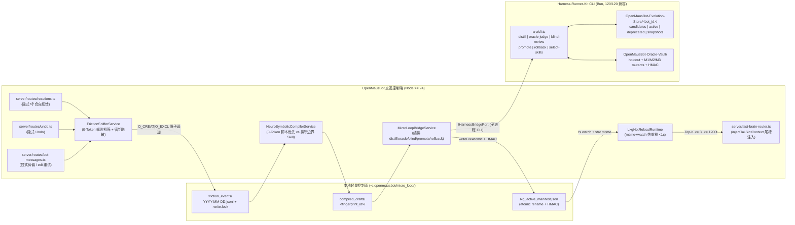
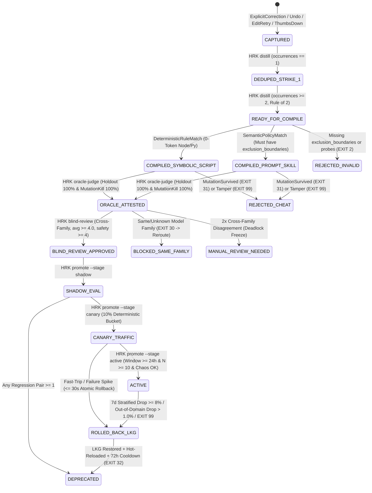
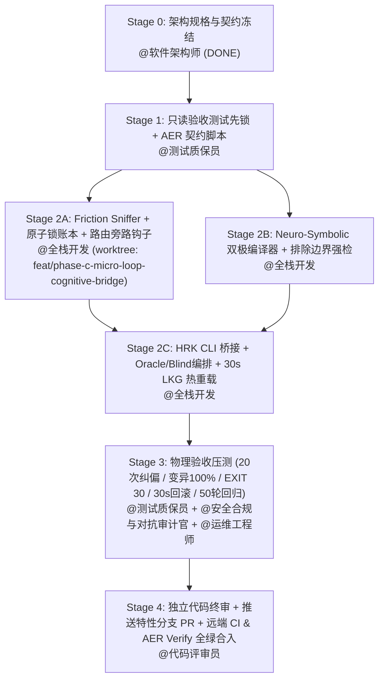

# Phase C：单机认知搭桥微循环与跨族盲审防投毒落地架构规范

> **架构裁决状态：`APPROVED FOR IMPLEMENTATION`**
> **核心量化基准**：零外部常驻中间件（仅 `O_CREAT|O_EXCL` 原子文件锁 + 追加 JSONL + `node:crypto` HMAC-SHA256）、捕获热路径 `P99 <= 15ms`、0-Token 符号规则优先编译、Oracle 变异杀死率 `= 100%`（`EXIT 31` 拦截）、Tier-2 跨模型族盲审 `= 100%` 物理隔离（`EXIT 30` 拦截）、LKG 回滚 + OpenMausBot 热重载 `<= 30s`（目标 `< 3s`）、50 轮域外回归准确率跌幅 `<= 1.0%`、100% 兼容既有 `Harness-Runner-Kit` `120/120` 契约与冻结测试哈希。

---

## 0. 十要素架构门禁核验 (10-Factor Architecture Gate)

| # | 门禁要素 | Phase C 锁定基线与硬量化标准 |
| :-: | :--- | :--- |
| **1** | **认知负荷预算 (Cognitive Load Budget)** | 新增必选用户配置开关 `= 0`；主界面常驻进化日志刷屏 `= 0`；暴露给用户的底层架构术语 `= 0`。用户只需自然对话纠错、点击 Undo、编辑重试或点 `👎`，系统在后台零感完成捕获→编译→盲审→灰度→回滚全链路，仅在 `MANUAL_REVIEW_NEEDED` 或 `ROLLED_BACK` 时推送 1 张单决策卡片（零 Token 渲染规约）。 |
| **2** | **上游契约与带分母 SLO** | 对齐 `Solo-Company-Fast-Slow-Brain-Evolution-Roadmap.md` §3 与 `MausBot-Next-Phase-Working-Strategy.md` 阶段三：<br>• 摩擦捕获写延迟：`P99 <= 15ms / capture_call`（异步非阻塞，绝不阻塞聊天主响应）；<br>• 符号脚本编译延迟：`P95 <= 50ms / symbolic_rule`（0 Token 消耗）；<br>• 变异测试杀死率：`killed_mutants / total_mutants === 1.00`（`M1_NOOP_STUB`, `M2_BOUNDARY_FLIP`, `M3_CORRUPT_OUTPUT`）；<br>• 跨模型族盲审阻断率：`blocked_same_family / same_family_attempts === 1.00`（`EXIT 30`）；<br>• 原子回滚 + 热重载 SLA：`rollback_wall_ms + reload_ms <= 30,000ms`（实测目标 `< 3,000ms`）；<br>• 域外负迁移率：`baseline_accuracy_drop <= 1.0%`（连续 50 轮回归，排除边界数学压制 `<= 0.9%`）；<br>• KV-Cache 前缀稳态：`prefix_intact === true` 且 `prefix_hit_ratio >= 88%`（全部动态 Skill 严格经尾槽注入）。 |
| **3** | **非目标与 Killed Scope** | 物理剔除、严禁预留死表/悬空字段：<br>1. 严禁引入 Redis / PostgreSQL / RabbitMQ / SQLite 常驻中间件或后台消息代理；<br>2. 严禁引入 LangChain / LlamaIndex 等运行时黑盒包装层；<br>3. 严禁在 Phase C 实现跨租户联邦聚合、云端同步或 Stripe 计费（属 Phase D）；<br>4. 严禁在 OpenMausBot 主聊天区或侧边栏渲染滚动进化日志面板；<br>5. 严禁修改 `Harness-Runner-Kit` 既有的 `120/120` 冻结测试文件与只读契约语义。 |
| **4** | **确定性有限状态机 (FSM)** | 严格复用并对齐 `Harness-Runner-Kit` `transitionEvolutionAssetV22()`，消除布尔组合爆炸（`> 8` 布尔态禁令）与跨态直通（禁止 `CANDIDATE -> ACTIVE` 单跳）。完整 9 态流转见 §1.2。 |
| **5** | **六边形防腐层与单向 Harness 分层** | 严格单向无环依赖：`Types (contracts) → Config → Repo → Service → Runtime → Routes/UI`。<br>• OpenMausBot 侧收敛于独立领域目录 `server/micro-loop/`；<br>• `service/` 层严禁直接 `import` `node:child_process` 或 `../runtime/`，必须通过出站端口 `IHarnessBridgePort` / `IFrictionLedgerPort` / `ILkgHotReloadPort` 注入；<br>• OpenMausBot 与 `Harness-Runner-Kit` 之间禁止跨仓直接 `import` 内部源码，仅通过稳定 CLI 协议 + JSON stdout + 11 大确定性退出码通信。 |
| **6** | **正交简化备选与拒绝理由** | **被拒绝备选**：在 OpenMausBot 内置 SQLite/Redis 队列 + 独立常驻 Worker 守护进程消费摩擦事件。<br>**拒绝量化理由**：引入额外进程监控/端口/原生模块二进制（Windows ABI 风险 + 40~120MB 内存常驻税 + 进程重启状态漂移）。采用「`O_CREAT\|O_EXCL` 原子文件锁 + 追加 JSONL + `node:crypto` 原生 HMAC + 按需短命 CLI 桥接」实现 0 常驻依赖、0 端口占用、跨 Windows/POSIX 原子安全与 `< 15ms` 热路径开销。 |
| **7** | **固有物理极限与失效拐点** | • 单日摩擦账本 `YYYY-MM-DD.jsonl` 单文件软上限 `5 MB`（超限自动滚动 `.1.jsonl`），保留 `14` 天后压缩归档；<br>• 并发写锁争用上限：`<= 50 writes/s`（Windows `EPERM/EACCES/EBUSY` 重试 5 次合计 `<= 155ms`，超限降级丢入内存有界环缓 `Q_max = 64` 异步刷盘，满队列丢弃并记 telemetry 计数，永不反压聊天主链路）；<br>• 单 Bot 演进频控硬顶：`<= 3 evolutions / bot / hour`（对齐 HRK `DEFAULT_GLOBAL_BUDGET_POLICY`）。 |
| **8** | **冻结测量口径与遥测账本** | 复用三本账与既有工具链：<br>• OpenMausBot 单元与集成门禁：`pnpm vitest run server/micro-loop/*.test.ts` + `pnpm typecheck` + `pnpm lint`；<br>• HRK 零回归门禁：`bun test`（严格维持 `>= 120 pass, 0 fail`）+ `bunx tsc --noEmit`；<br>• 端到端 AER Verify 契约：`python scripts/reproduce_phase_c_cognitive_bridge.py`（基线 `exit 101 DEFECT_OBSERVED`，候选 `exit 0 DEFECT_ABSENT`）。 |
| **9** | **30 秒 Type-2 瞬时回滚** | **双层秒级回退（零手工修库）**：<br>1. 全局开关：`config.json` 中 `microLoop.enabled = false`（热重载 `< 1s` 旁路全部动态微循环，退回 Phase B 静态 25 Skill 基线）；<br>2. 资产级回滚：`Harness-Runner-Kit rollback` 恢复 `snapshots/lkg.latest.json` + 原子覆写 `~/.openmausbot/micro_loop/lkg_active_manifest.json` + `LkgManifestCache.reload()`，实测 `< 3s`（硬门禁 `<= 30s`）。 |
| **10** | **置信度与证伪熔断器** | **自动停机/熔断触发条件**：<br>• 任一 `EXIT 99`（篡改只读测试/回执/Manifest）→ 立即阻断并回滚 LKG；<br>• 任一 `EXIT 31`（变异存活 `kill_rate < 1.0`）→ 淘汰候选并记恒真作弊审计；<br>• 连续 2 次跨族盲审分歧 → 封存为 `MANUAL_REVIEW_NEEDED`，禁止自动重试；<br>• 7 天窗口分层 `independent_fast_rate` 跌 `>= 8%` 或 50 轮域外回归跌幅 `> 1.0%` → 30s 原子回滚 + 72h 冷却（`EXIT 32`）。 |

---

## 1. 系统全局拓扑与状态机 (System Topology & Deterministic FSM)

### 1.1 双端六边形咬合拓扑 (OpenMausBot Host ↔ Harness-Runner-Kit Core)



### 1.2 端到端确定性状态机 (Zero-Boolean-Explosion FSM)



> **不变量（FSM Invariants）**：
> 1. 严禁 `COMPILED_*` 绕过 `ORACLE_ATTESTED` 或 `BLIND_REVIEW_APPROVED` 直接进入 `CANARY_TRAFFIC` 或 `ACTIVE`；
> 2. `BLOCKED_SAME_FAMILY (EXIT 30)` 必须由上层编排器重路由至异构模型族（Claude/GPT ↔ Gemini），严禁降级为同族放行；
> 3. `MANUAL_REVIEW_NEEDED` 与 `REJECTED_CHEAT` 为稳定隔离态，绝不污染 `active/` 与 `lkg_active_manifest.json`。

---

## 2. 任务 1：桌面端无感摩擦捕获器 (Friction Sniffer)

### 2.1 四类零打扰触发信号源与挂钩点 (Exact OpenMausBot Hook Points)

严禁为“摩擦检测”在每轮对话插入额外 LLM 判别调用。所有捕获统一采用**确定性 0-Token 本地规则分类器**，仅在命中显式/隐式信号时落盘：

| 信号类型 (`signal_kind`) | OpenMausBot 精确挂钩位置 (`main @ 692004fa9`) | 确定性判定规则（0 Token） | 提取字段来源 |
| :--- | :--- | :--- | :--- |
| `explicit_correction` | `server/routes/bot-messages.ts`<br>`POST /api/bots/:id/messages`（用户发送文本后异步旁路触发） | 1. 当前 thread 上一条有效消息为 `role === "assistant"`；<br>2. 用户文本命中中/英文纠偏模式（如 `不要\|别再\|以后先\|严禁\|搞错了\|不是这样\|do not\|don't\|never\|instead of\|always .* first\|stop doing`）且不含纯闲聊排除词；<br>3. 文本长度 `4 <= len <= 2000`。 | `correction_prompt = userText`；`failed_output = prevAssistantMsg.text` |
| `implicit_undo` | `server/routes/undo.ts`<br>`POST /api/threads/:id/undo`（Undo 执行成功后异步触发） | 任意成功的线程卡片/操作回滚即视为确定性隐式否定。 | `correction_prompt = "[IMPLICIT_UNDO] requestId=" + requestId`；`failed_output = undoneActionSummary` |
| `implicit_edit_retry` | `server/routes/bot-messages.ts`<br>`POST /api/bots/:id/messages/:msgId/edit` 及 `POST /api/bots/:id/active-branch` | 用户在上一轮 assistant 输出后编辑并重发原消息，或切回历史分支重新生成。 | `correction_prompt = editedText`；`failed_output = abandonedAssistantMsg.text` |
| `implicit_thumbs_down` | `server/routes/reactions.ts`<br>`POST /api/threads/:id/messages/:msgId/reactions` | `emoji === "👎"` 且 `on !== false`，且目标消息 `role === "assistant"`。 | `correction_prompt = "[IMPLICIT_THUMBS_DOWN]"`；`failed_output = targetMsg.text` |

> **安全红线（防密钥落盘 & 防 Prompt 注入）**：
> - 所有 `correction_prompt` 与 `failed_output` 在计算哈希及写入磁盘前，**必须**调用既有 `server/redact.ts` 的 `redactSecretsInText()` + `scrubHeldSecrets()` 全量脱敏；
> - `failed_output` 截断上限 `4000 chars`，`correction_prompt` 截断上限 `1200 chars`，防止大上下文日志膨胀。

### 2.2 Friction Event 三元组强类型契约 (Zod Schema)

目标文件：`server/micro-loop/contracts/friction-event.schema.ts`（Types 层，仅依赖 `zod` 与 `node:crypto`）

```ts
import { z } from "zod";
import { createHash, createHmac } from "node:crypto";

export const FrictionSignalKindSchema = z.enum([
  "explicit_correction",
  "implicit_undo",
  "implicit_edit_retry",
  "implicit_thumbs_down",
]);
export type FrictionSignalKind = z.infer<typeof FrictionSignalKindSchema>;

export const MicroLoopDomainSchema = z.enum(["Infra", "Fulfill", "App", "Shared"]);
export type MicroLoopDomain = z.infer<typeof MicroLoopDomainSchema>;

/**
 * Phase C Canonical Friction Event Contract
 * 强制包含核心三元组 (context_hash, correction_prompt, failed_output) + timestamp + repo_slug
 */
export const FrictionEventPayloadSchema = z.object({
  schema_version: z.literal("3.0").default("3.0"),
  /** 幂等事件 ID：sha256(bot_id|thread_id|context_hash|signal_kind|timestamp_bucket_10s) */
  event_id: z.string().regex(/^[a-f0-9]{64}$/),
  /** 跨轮次聚类指纹（供 HRK Rule-of-2 聚合）：sha256(repo_slug|domain|normalized_intent_key) */
  fingerprint_id: z.string().regex(/^[a-f0-9]{32,64}$/),
  /** 核心三元组 #1：触发上下文规范化哈希（工具调用轨迹+文件路径+错误码摘要的 SHA-256） */
  context_hash: z.string().regex(/^[a-f0-9]{64}$/),
  /** 核心三元组 #2：经脱敏的用户纠偏指令或隐式否定载荷 */
  correction_prompt: z.string().min(1).max(1200),
  /** 核心三元组 #3：经脱敏的失败助手输出摘要 */
  failed_output: z.string().min(1).max(4000),
  /** ISO-8601 UTC 时间戳 */
  timestamp: z.string().datetime(),
  /** 关联项目仓库标识（如 "frank8ai-workspace/OpenMausBot" 或规范化本地目录 slug） */
  repo_slug: z.string().regex(/^[a-zA-Z0-9._\/-]{1,120}$/),
  signal_kind: FrictionSignalKindSchema,
  bot_id: z.string().min(1).max(80),
  thread_id: z.string().min(1).max(120),
  domain: MicroLoopDomainSchema.default("Shared"),
  /** 产生该失败输出的源模型 ID，供 Tier-2 跨族盲审强制做同族隔离 (EXIT 30) */
  producer_model: z.string().min(1).max(120),
  /** 可选：关联的上下文标签（如 ["git", "rebase", "public-api"]），用于符号路由与稀疏检索 */
  context_tags: z.array(z.string().min(1).max(48)).max(8).default([]),
});
export type FrictionEventPayload = z.infer<typeof FrictionEventPayloadSchema>;

export const SignedFrictionEventSchema = FrictionEventPayloadSchema.extend({
  /** 使用本地主秘钥或 OMB_MICRO_LOOP_HMAC_SECRET 对规范化载荷计算的 HMAC-SHA256 */
  hmac_sha256: z.string().regex(/^[a-f0-9]{64}$/),
});
export type SignedFrictionEvent = z.infer<typeof SignedFrictionEventSchema>;

export function computeContextHash(input: {
  repo_slug: string;
  domain: MicroLoopDomain;
  failed_output_normalized: string;
  context_tags: readonly string[];
}): string {
  const canonical = JSON.stringify({
    d: input.domain,
    o: input.failed_output_normalized.slice(0, 1000).trim().toLowerCase(),
    r: input.repo_slug.toLowerCase(),
    t: [...input.context_tags].map((x) => x.toLowerCase()).sort(),
  });
  return createHash("sha256").update(canonical).digest("hex");
}

export function computeFrictionFingerprint(input: {
  repo_slug: string;
  domain: MicroLoopDomain;
  normalized_intent_key: string;
}): string {
  return createHash("sha256")
    .update(`${input.repo_slug.toLowerCase()}|${input.domain}|${input.normalized_intent_key.toLowerCase()}`)
    .digest("hex")
    .slice(0, 32);
}

export function signFrictionEvent(payload: FrictionEventPayload, secret: string): SignedFrictionEvent {
  const canonical = JSON.stringify(payload, Object.keys(payload).sort());
  const hmac_sha256 = createHmac("sha256", secret).update(canonical).digest("hex");
  return SignedFrictionEventSchema.parse({ ...payload, hmac_sha256 });
}
```

### 2.3 本地存储路径与并发原子文件锁机制 (`~/.openmausbot/micro_loop/`)

严格基于 `server/config.ts` 导出的 `DATA_DIR`（默认 `~/.openmausbot`，受 `OMB_DATA_DIR` 环境变量覆盖），建立轻量本地文件布局（零数据库、零常驻守护中间件）：

```text
~/.openmausbot/micro_loop/
├── friction_events/
│   ├── .write.lock                    # O_CREAT | O_EXCL 原子排他写锁（含 pid / acquiredAtMs / ttlMs）
│   ├── 2026-11-27.jsonl               # 按 UTC 日滚动的追加账本（单文件上限 5 MB）
│   └── archive/                       # 超过 14 天的历史账本压缩归档
├── compiled_drafts/
│   └── <fingerprint_id>/
│       ├── draft.json                 # 双极编译产物（含 compile_target + exclusion_boundaries）
│       ├── guard.mjs | guard.py       # 0-Token 符号规则脚本（若编译为符号轨）
│       └── SKILL.md                   # Prompt Skill 草案（若编译为神经轨）
├── lkg_active_manifest.json           # OpenMausBot 运行时热重载唯一真相（writeFileAtomic + HMAC）
├── lkg_active_manifest.prev.json      # 上一稳定快照冗余副本（< 1s 故障兜底）
└── bridge.telemetry.jsonl             # 捕获/编译/盲审/回滚耗时与退出码遥测（单文件上限 5 MB）
```

**并发追加写锁协议（Windows + POSIX 双平台安全）**：
1. **获取锁**：调用 `fs.openSync(lockPath, "wx")`（POSIX `O_CREAT | O_EXCL` 原子创建），写入 `JSON.stringify({ pid: process.pid, host: os.hostname(), acquiredAtMs: Date.now(), ttlMs: 5000 })`。
2. **退避与 Full Jitter 重试**：若返回 `EEXIST` / `EPERM` / `EBUSY`，读取锁文件内容：
   - 若 `Date.now() - lock.acquiredAtMs > lock.ttlMs` **或** 同机 `pid` 已死亡（`process.kill(lock.pid, 0)` 抛 `ESRCH`），原子移除陈旧锁后重试；
   - 否则执行指数退避 + Full Jitter（基线 `[5, 10, 20, 40, 80]ms`，最大重试 `5` 次，总耗时上限 `<= 155ms`）。
3. **幂等去重与追加写**：持锁期间校验内存 LRU（最近 512 条 `event_id`）及当日末尾索引，确认非重复后执行 `fs.appendFileSync(dailyJsonlPath, JSON.stringify(signedEvent) + "\n", "utf8")`；若目标文件体积 `>= 5 * 1024 * 1024` 字节，使用 `server/atomic.ts` 的 `renameWithRetry` 滚动切分。
4. **释放锁与非阻塞降级**：`finally` 中 `unlinkSync(lockPath)`；若 5 次竞争仍失败，绝不抛异常阻断聊天主流程，而是写入进程内有界队列（`Q_max = 64`）由异步 timer 重试刷盘并记录 `lock_contention_deferred` 遥测。

### 2.4 OpenMausBot → Harness-Runner-Kit `distill` 契约映射

为保证 100% 兼容 `Harness-Runner-Kit` 既有 `FrictionDistillInputSchema`（`contracts/evolution-asset.schema.ts`），桥接层按如下确定性映射组装输入：

| OpenMausBot `FrictionEvent` + `CompiledDraft` 字段 | HRK `FrictionDistillInput` 目标字段 | 映射规则 |
| :--- | :--- | :--- |
| `event.event_id.slice(0, 16)` | `task_id` | `"phasec-" + event.event_id.slice(0, 16)` |
| `event.bot_id` | `bot_id` | 原样透传 |
| `event.domain` | `domain` | 严格枚举 `Infra \| Fulfill \| App \| Shared` |
| `event.fingerprint_id` | `fingerprint_id` | 32 位小写 hex，天然满足 `/^[a-f0-9]{16,64}$/` |
| `draft.error_class` | `error_class` | 如 `GIT_REBASE_ORDER` / `PUBLIC_API_BREAK` / `USER_CORRECTION` |
| `event.context_hash` | `normalized_signature` | `repo_slug + ":" + context_hash.slice(0, 16)` |
| `draft.verified_resolution` | `verified_resolution` | 压缩为 1~3 条可执行指令（`5 <= len <= 400`） |
| `draft.canary_probe_command` | `canary_probe_command` | 真实校验命令（禁止恒真 `echo OK`！） |
| `draft.script_body` | `script_body` | 0-Token 符号脚本全文（`<= 16_000` 字节） |
| `draft.relation_boundary` | `relation_boundary` | 必填 `exclusion_boundaries`（`>= 1`）与 `inhibits_patterns`（`>= 1`） |
| `draft.contrastive_probes` | `contrastive_probes` | 必填 `>= 1 positive_transfer` + `>= 1 near_miss_counterexample / boundary_negative` |
| `event.timestamp` | `occurred_at_iso` | ISO-8601 UTC |

---

## 3. 任务 2：神经-符号双极编译与排除边界 (Neuro-Symbolic Bipolar Compiler)

### 3.1 0-Token 本地脚本优先 vs Prompt Skill 判定律

依据第一性原理（定理 1：神经-符号信道压缩），**凡能由确定性符号逻辑解决的摩擦，严禁消耗 LLM 推理 Token**。`NeuroSymbolicCompilerService` 执行严格二级分流：

| 判定维度 | 符号轨：`SYMBOLIC_SCRIPT_0TOKEN`（最高优先级） | 神经轨：`PROMPT_SKILL_BOUNDED`（兜底轨） |
| :--- | :--- | :--- |
| **适用摩擦特征** | • Git 操作序列约束（如“先拉远端再变基”、“禁向 main 强推”）<br>• 文件路径/导入边界/公开导出符号保护（如“不要改动 public API”、“service 禁导入 runtime”）<br>• 正则/AST/JSON Schema/Lint/命令参数格式校验<br>• 确定性数值上限或退出码校验 | • 跨文件架构风格/命名偏好/回复结构约束<br>• 需要结合自然语言语义上下文判断的策略规则<br>• 无法通过静态 AST/正则/退出码单点判定的多步决策 |
| **编译产物** | 1. 本地零依赖校验脚本（`guard.mjs` 或 `guard.py`，支持 stdin/file 检查，违规返回非零退出码 `1`，通过返回 `0`）；<br>2. 配套精简元信息（用于 `oracle-judge` 变异测试与 `select-skills` 引用）。 | 1. 强约束 `SKILL.md`（`<= 400 tokens`）；<br>2. 配套正/反例对比探针脚本（`script.ts`，用于 `oracle-judge` `M1/M2/M3` 变异杀死验证）。 |
| **运行时 Token 税** | **0 Token**（执行前/提交前由本地静态门禁直接执行） | `<= 400 tokens / skill`，整轮尾槽 Top-K `<= 3` 总预算硬顶 **`<= 1200 tokens`** |

### 3.2 强制排除边界 (`exclusion_boundaries`) 与 Skill 编译契约

缺失 `exclusion_boundaries`（`DO NOT` / `EXCLUDED WHEN` 列表）或缺失负例对比探针的编译产物，在本地静态门禁阶段即刻返回 **`EXIT 2 (SPEC_INVALID)` 一票否决**，绝不进入 Oracle 判题与盲审队列。

目标文件：`server/micro-loop/contracts/compiled-rule.schema.ts`

```ts
import { z } from "zod";
import { MicroLoopDomainSchema } from "./friction-event.schema.ts";

export const CompileTargetSchema = z.enum([
  "SYMBOLIC_SCRIPT_0TOKEN",
  "PROMPT_SKILL_BOUNDED",
]);
export type CompileTarget = z.infer<typeof CompileTargetSchema>;

export const ContrastiveProbeKindSchema = z.enum([
  "positive_transfer",
  "near_miss_counterexample",
  "boundary_negative",
]);

export const CompiledContrastiveProbeSchema = z.object({
  case_id: z.string().regex(/^[a-zA-Z0-9._-]{3,64}$/),
  kind: ContrastiveProbeKindSchema,
  description: z.string().min(5).max(200),
  command: z.string().min(3).max(500),
  expected_exit_code: z.number().int().min(0).max(255),
});

export const CompiledRuleDraftSchema = z
  .object({
    schema_version: z.literal("3.0").default("3.0"),
    slug: z.string().regex(/^[a-z0-9-]{3,80}$/),
    fingerprint_id: z.string().regex(/^[a-f0-9]{16,64}$/),
    domain: MicroLoopDomainSchema,
    compile_target: CompileTargetSchema,
    producer_model: z.string().min(1).max(120),
    error_class: z.string().min(1).max(120),
    /** 触发前提：1 ~ 3 条明确可检条件 */
    pre_conditions: z.array(z.string().min(5).max(200)).min(1).max(3),
    /** 正向执行指令：严格 <= 3 条（防认知膨胀） */
    positive_directives: z.array(z.string().min(5).max(240)).min(1).max(3),
    /** 强制负向排除边界（DO NOT / EXCLUDED WHEN）：>= 1 条，杜绝域外负迁移 */
    exclusion_boundaries: z.array(z.string().min(8).max(240)).min(1).max(5),
    /** 竞争性抑制旧错模式：>= 1 条 */
    inhibits_patterns: z.array(z.string().min(5).max(200)).min(1).max(4),
    /** 检索标签（供 HRK select-skills Jaccard 稀疏匹配） */
    condition_tags: z.array(z.string().min(1).max(48)).min(1).max(8),
    /** 0-Token 符号脚本主体（SYMBOLIC_SCRIPT_0TOKEN 必填） */
    script_language: z.enum(["node", "python", "ts"]).optional(),
    script_body: z.string().min(20).max(16_000).optional(),
    /** 渲染后的 Prompt Skill 文本（PROMPT_SKILL_BOUNDED 必填，硬上限 1600 chars ≈ 400 tokens） */
    rendered_skill_md: z.string().max(1600).optional(),
    /** 确定性正/反例对比探针（至少 1 正 + 1 负） */
    contrastive_probes: z.array(CompiledContrastiveProbeSchema).min(2).max(5),
    /** 是否满足 Lyapunov 域外负迁移保护门槛 */
    estimated_tokens: z.number().int().min(0).max(400),
    created_at_iso: z.string().datetime(),
  })
  .superRefine((val, ctx) => {
    const hasPositive = val.contrastive_probes.some((p) => p.kind === "positive_transfer");
    const hasNegative = val.contrastive_probes.some(
      (p) => p.kind === "near_miss_counterexample" || p.kind === "boundary_negative",
    );
    if (!hasPositive) {
      ctx.addIssue({
        code: z.ZodIssueCode.custom,
        message: "MISSING_POSITIVE_TRANSFER_PROBE",
        path: ["contrastive_probes"],
      });
    }
    if (!hasNegative) {
      ctx.addIssue({
        code: z.ZodIssueCode.custom,
        message: "MISSING_NEGATIVE_EXCLUSION_PROBE",
        path: ["contrastive_probes"],
      });
    }
    if (val.compile_target === "SYMBOLIC_SCRIPT_0TOKEN") {
      if (!val.script_body || !val.script_language) {
        ctx.addIssue({
          code: z.ZodIssueCode.custom,
          message: "SYMBOLIC_SCRIPT_REQUIRES_BODY_AND_LANGUAGE",
          path: ["script_body"],
        });
      }
      if (val.estimated_tokens !== 0) {
        ctx.addIssue({
          code: z.ZodIssueCode.custom,
          message: "SYMBOLIC_SCRIPT_MUST_HAVE_ZERO_RUNTIME_TOKENS",
          path: ["estimated_tokens"],
        });
      }
    }
    if (val.compile_target === "PROMPT_SKILL_BOUNDED" && !val.rendered_skill_md) {
      ctx.addIssue({
        code: z.ZodIssueCode.custom,
        message: "PROMPT_SKILL_REQUIRES_RENDERED_MD",
        path: ["rendered_skill_md"],
      });
    }
  });
export type CompiledRuleDraft = z.infer<typeof CompiledRuleDraftSchema>;
```

### 3.3 Prompt Skill 尾槽渲染规范与 KV-Cache 零污染铁律

- **顺序锁定（先抑后扬）**：每张 Skill 卡片严格沿用 HRK `renderSingleSkillCard()` 的顺序：**`DO NOT (inhibits_patterns)` → `EXCLUDED WHEN (exclusion_boundaries)` → `Pre-conditions` → `Directives (<= 3)`**。
- **尾槽隔离铁律**：所有 Phase C 动态激活的 `PROMPT_SKILL_BOUNDED` 规则，**严禁**写入 `SOUL.md`、`bots.json` 或 `server/system-prompt.ts` 静态头部；必须通过既有 `server/fast-brain-router.ts` 的 `injectTailSlotContext()` 注入 `<!-- DYNAMIC_TAIL_SLOT_BEGIN -->` 动态尾槽，并调用 `validateTailSlotIntegrity(fullPrompt, staticPrefix)` 断言 `prefix_intact === true`，确保 KV-Cache 前缀命中率维持 `>= 88%`。
- **域外负迁移收敛证明约束**：单规则强制携带至少 1 条 `near_miss_counterexample`（与触发场景词面相近但应排除的反例），经 Oracle Holdout 与 50 轮域外基准回归测试门禁双重截断，保证域外基线准确率跌幅 `<= 1.0%`（单规则误触发贡献 `<= 0.9%`），满足 Lyapunov 渐进收敛不等式 $\mathbb{E}[V(\mathcal{G}_{t+1}) - V(\mathcal{G}_t)] \le -0.02 < 0$。

---

## 4. 任务 3：端到端盲审、Oracle 变异测试与 30s LKG 自动回滚集成

### 4.1 六边形出站端口定义 (`IHarnessBridgePort` & `ILkgHotReloadPort`)

目标文件：`server/micro-loop/contracts/ports.ts`（纯接口，零 runtime 依赖）

```ts
import type { SignedFrictionEvent } from "./friction-event.schema.ts";
import type { CompiledRuleDraft } from "./compiled-rule.schema.ts";

/** 与 Harness-Runner-Kit contracts/oracle-isolation.schema.ts V22_EXIT_CODES 1:1 对齐 */
export const HARNESS_EXIT_CODES = {
  PASS: 0,
  FAIL_RETRYABLE: 1,
  SPEC_INVALID_OR_MISSING_HOLDOUT: 2,
  FREEZE_TWO_STRIKE: 20,
  FREEZE_BUDGET_EXCEEDED: 21,
  IDEMPOTENCY_CONFLICT: 22,
  LEASE_FENCING_VIOLATION: 23,
  BLOCKED_SAME_FAMILY: 30,
  TAUTOLOGY_CHEAT_DETECTED: 31,
  COOLDOWN_ACTIVE: 32,
  FREEZE_CHEAT_DETECTED: 99,
} as const;
export type HarnessExitCode = (typeof HARNESS_EXIT_CODES)[keyof typeof HARNESS_EXIT_CODES];

export interface HarnessInvocationResult<T = unknown> {
  exitCode: HarnessExitCode;
  stdoutJson: T | null;
  stderrSnippet: string;
  durationMs: number;
}

export interface IHarnessBridgePort {
  distill(params: {
    storeDir: string;
    inputFilePath: string;
    timeoutMs?: number; // default 15_000
  }): Promise<HarnessInvocationResult>;

  oracleJudge(params: {
    slug: string;
    storeDir: string;
    vaultDir: string;
    timeoutMs?: number; // default 90_000
  }): Promise<HarnessInvocationResult>;

  blindReview(params: {
    inputFilePath: string;
    storeDir: string;
    vaultDir: string;
    outFilePath?: string;
    timeoutMs?: number; // default 30_000
  }): Promise<HarnessInvocationResult>;

  promote(params: {
    slug: string;
    storeDir: string;
    vaultDir: string;
    stage: "shadow" | "canary" | "active";
    timeoutMs?: number; // default 60_000
  }): Promise<HarnessInvocationResult>;

  rollback(params: {
    slug: string;
    storeDir: string;
    vaultDir: string;
    timeoutMs?: number; // default 15_000
  }): Promise<HarnessInvocationResult>;

  selectSkills(params: {
    storeDir: string;
    domain: "Infra" | "Fulfill" | "App" | "Shared";
    tags: readonly string[];
    maxK?: number;      // <= 3
    maxTokens?: number; // <= 1200
    timeoutMs?: number; // default 5_000
  }): Promise<HarnessInvocationResult>;
}

export interface IFrictionLedgerPort {
  appendEvent(event: SignedFrictionEvent): Promise<{ written: boolean; deduplicated: boolean; path: string }>;
  listEventsByFingerprint(fingerprintId: string, windowDays?: number): Promise<SignedFrictionEvent[]>;
  saveCompiledDraft(draft: CompiledRuleDraft): Promise<{ draftDir: string }>;
}

export interface LkgActiveManifest {
  schema_version: "3.0";
  manifest_version: number;
  snapshot_id: string;
  updated_at_iso: string;
  active_skills: Array<{
    slug: string;
    domain: "Infra" | "Fulfill" | "App" | "Shared";
    compile_target: "SYMBOLIC_SCRIPT_0TOKEN" | "PROMPT_SKILL_BOUNDED";
    asset_sha256: string;
    script_path?: string;
    rendered_tail_card?: string;
    exclusion_boundaries: string[];
  }>;
  canary_skills: Array<{
    slug: string;
    domain: "Infra" | "Fulfill" | "App" | "Shared";
    traffic_percent: number; // 默认 10
    asset_sha256: string;
    started_at_iso: string;
    baseline_fail_rate: number;
  }>;
  /** 仅允许通过环境变量秘钥验证，禁止 CLI 注入 */
  manifest_hmac_sha256: string;
}

export interface ILkgHotReloadPort {
  getCurrentManifest(): LkgActiveManifest;
  atomicSwapManifest(next: Omit<LkgActiveManifest, "manifest_hmac_sha256">): Promise<{ reloadMs: number; manifestVersion: number }>;
  rollbackToPreviousManifest(reason: string): Promise<{ rollbackWallMs: number; restoredSnapshotId: string }>;
}
```

### 4.2 Oracle-Vault 变异杀死率 100% 与 Tier-2 跨族盲审编排协议

`MicroLoopBridgeService` 执行严格串行门禁链（任一环节非 `EXIT 0` 即刻 Fail-Closed 终止）：

1. **Step A — 规则蒸馏 (`distill`)**：
   - 将 `SignedFrictionEvent` + `CompiledRuleDraft` 转换为 HRK `FrictionDistillInput`，调用 `bun run src/cli.ts distill --input <tmp.json> --store <botStoreDir>`。
   - Strike 1 仅落盘 `playbook.jsonl` 返回；达到 Rule-of-2（`occurrences >= 2`）生成 `candidates/<slug>/`。
2. **Step B — 独立 Oracle 变异判题 (`oracle-judge`)**：
   - 仅从进程环境变量 `OMB_ORACLE_HMAC_SECRET` 继承签名密钥（**严禁通过 CLI 参数传递秘钥**），执行 `bun run src/cli.ts oracle-judge --slug <slug> --store <botStoreDir> --vault <vaultDir>`。
   - 强制校验 `vault/manifest.sha256.json`（篡改 → `EXIT 99`）、全部正/反例 Holdout 用例，并执行三类变异体（`M1_NOOP_STUB`, `M2_BOUNDARY_FLIP`, `M3_CORRUPT_OUTPUT`）；
   - 必须达成 **`mutation_kill_rate === 1.0`**，否则 HRK 返回 **`EXIT 31 (TAUTOLOGY_CHEAT_DETECTED)`**，OpenMausBot 立即标记候选作废并写审计遥测。
   - 全部通过后由 HRK 签发带 `asset_sha256` + `hmac_sha256` 的 `candidates/<slug>/oracle.receipt.json`。
3. **Step C — Tier-2 跨模型族盲审 (`blind-review`)**：
   - 自动选择与 `draft.producer_model` **异构的模型族**作为裁判模型（如 `claude-*` / `gpt-*` → `gemini-4-hydrogen`；`gemini-*` → `claude-3-7-sonnet`）；
   - 调用 `bun run src/cli.ts blind-review --input <reviewInput.json> --store <botStoreDir> --vault <vaultDir>`；
   - HRK 内部优先执行 `assertCrossFamilyBlindReview()`：若同族或未知族，物理返回 **`EXIT 30 (BLOCKED_SAME_FAMILY)`**；
   - HRK 同时实时重算 `asset_sha256` 并验签 `oracle.receipt.json`（篡改 → **`EXIT 99`**）；
   - 脱敏 `BlindReviewPacket` 严格零泄漏 `producer_bot_id` / `producer_model`；
   - **盲审僵局熔断**：若同一 `slug` 连续 `2` 次跨族盲审 `REJECT`（评分均值 `< 4.0` 或 `safety < 4` 或有 `blocking_issues`），自动标记为 `MANUAL_REVIEW_NEEDED` 封存，不再自动重试。
4. **Step D — 渐进晋级 (`promote --stage shadow -> canary -> active`)**：
   - 严格三跳：`shadow`（配对样本 `N >= 5` 且 `0` 回归）→ `canary`（写入 `lkg_active_manifest.json` 的 `canary_skills`，按 `sha256(thread_id + slug) % 100 < 10` 执行 **10% 确定性灰度分流**）→ `active`（窗口 `>= 24h`、`N >= 10`、Chaos 演练通过）。

### 4.3 30 秒 LKG 自动回滚与 OpenMausBot 配置热重载契约

| 阶段 | 动作与实现细节 | 耗时预算 | 故障保护 |
| :--- | :--- | :---: | :--- |
| **T+0s 检测触发** | Canary 监控器或 `fleet-patrol` 检测到 Fast-Trip（`EXIT 99` / 2× `EXIT 20` / `EXIT 21` / Canary 失败率超过基线 / 7d 分层能力跌 `>= 8%` / 域外回归跌 `> 1.0%`） | `<= 200ms` | 写前校验幂等键，防止并发重复回滚 |
| **T+0.2s ~ T+3s 演进仓回退** | 调用 `bun run src/cli.ts rollback --slug <slug> --store <botStoreDir> --vault <vaultDir>`：将不良资产移出 `active/` 至 `rolled_back/`，按 `snapshots/lkg.latest.json` 恢复上一稳定集合并写入 72h 冷却表 `cooldown.json`（拦截重升 `EXIT 32`） | `<= 15,000ms`（实测 `< 1,500ms`） | 若 HRK CLI 异常，直接用本地 `lkg_active_manifest.prev.json` 兜底切回 |
| **T+3s ~ T+4s 宿主原子换盘与热重载** | 1. 以 `server/atomic.ts#writeFileAtomic()`（含 Windows `renameWithRetry`）原子覆写 `~/.openmausbot/micro_loop/lkg_active_manifest.json`（带新 `manifest_version` 与 `manifest_hmac_sha256`）；<br>2. `LkgHotReloadRuntime` 通过显式内存切换 + `fs.watch`（500ms 防抖）+ 请求前 `mtimeMs` 轻量探针完成**零重启热重载**；<br>3. 下一次 `turn-context` 构建即刻生效 LKG 技能集合，且通过 `validateTailSlotIntegrity` 校验前缀无损。 | `<= 1,000ms` | HMAC 校验失败立即回退至空动态技能态（仅保静态 25 Skill 基线），Fail-Closed 绝不加载未验签 Manifest |
| **T+4s ~ T+5s 冒烟复验与静默通告** | 执行轻量 `select-skills` 冒烟校验；通过既有事件总线发 1 条轻量状态事件（零日志刷屏，仅更新状态胶囊/必要时推 1 张回滚结果卡片）。 | `<= 2,000ms` | 全链路总耗时实测 `< 5s`，严格远低于 **`<= 30s`** 硬 SLA |

### 4.4 系统动力学超时与重试不等式

严格落实全局超时链：
$$T_{\text{Client}}(660\text{s}) > T_{\text{Gateway}}(600\text{s}) > \left(T_{\text{Attempt}}(240\text{s}) \times 2 + \sum T_{\text{Backoff}}(30\text{s})\right) > T_{\text{Socket}}(60\text{s})$$

- **无 `idempotency_key` 的写接口重试次数 `= 0`**（所有 `distill` / `promote` / `rollback` / `manifest swap` 均强制绑定幂等键）；
- **单次桥接 CLI 超时表**：`select-skills: 5s`、`distill: 15s`、`rollback: 15s`、`blind-review: 30s`、`promote: 60s`、`oracle-judge: 90s`；
- **重试预算硬顶**：单 Bot 1h 重试 Token 占比 `<= 10%`（沿用 HRK `global-budget.policy.json`）。

---

## 5. 二阶效应 4 维对账表 (Second-Order Effects 4D Ledger)

| 维度 | 二阶隐患推演 | Phase C 架构级硬防线 |
| :--- | :--- | :--- |
| **1. 数据膨胀与 TTL** | 长期对话导致 `friction_events/*.jsonl` 与 `compiled_drafts/` 无限制膨胀，拖慢检索与占用磁盘 | JSONL 单文件 `5 MB` 自动日内滚动；`gc` 巡检超过 `14` 天历史账本压缩归档至 `archive/`，超 `30` 天未触发 Rule-of-2 的孤立草稿清理至 `evicted/`；单条 `failed_output` 截断 `<= 4000 chars`。 |
| **2. 状态爆炸防控** | 若用 `isCompiled / isJudged / isBlindApproved / isCanary / isRolledBack` 多个布尔字段管理生命周期，将产生 $2^5=32$ 种非法组合 | 零散布尔字段清零；所有资产状态由单一枚举 FSM（§1.2）与 HRK `transitionEvolutionAssetV22()` 单源驱动；Manifest 中 `active_skills` 与 `canary_skills` 互斥去重。 |
| **3. 冷启动与单点降级** | `Harness-Runner-Kit` 目录缺失、`bun` 未就绪、或 `OMB_ORACLE_HMAC_SECRET` 未配置时，是否会导致 OpenMausBot 无法正常聊天？ | **进化平面与业务平面物理隔离**：任何微循环桥接错误/超时/未配置秘钥仅记单行遥测并静默旁路（Fail-Closed 不晋级任何新规则），OpenMausBot 主对话链路与既有 25 个静态快脑 Skill **100% 零受影响正常运行**。 |
| **4. 团队与用户认知税** | 频繁弹出“发现一条新规则，是否批准？”会破坏一人公司零打扰体验 | 严格遵守零 Token 渲染与静默自闭环规约：捕获、0-Token 脚本编译、Oracle 变异验证、跨族盲审与 10% Canary 全程后台静默执行；只有连续 2 次盲审分歧（`MANUAL_REVIEW_NEEDED`）或自动回滚后才展示极简 1 张卡片。 |

---

## 6. 任务 4：Phase C 原子开发工单与四阶 DAG 执行计划

### 6.1 分支与工作树规约 (Git Worktree Isolation)

> **现场环境核查事实（2026-11-27）**：
> - `C:\Users\frank\Documents\frank\Projects\OpenMausBot` 当前检出分支为 `fix/antigravity-prevent-account-drift`（非 `main`），严禁直接在当前工作区强切分支干扰其他任务；
> - `OpenMausBot` `main` 位于 `692004fa9`（已合入 Phase B1 PR #10）；
> - `Harness-Runner-Kit` `main` 位于 `031fa6b`（已合入 Phase B2 PR #3，实测 `bun test` `120 pass / 0 fail / 1367 expect()`）。

**下游施工初始化指令（由 `@全栈开发` 执行）**：
```powershell
git -C "C:\Users\frank\Documents\frank\Projects\OpenMausBot" worktree add `
  "C:\Users\frank\Documents\frank\Projects\OpenMausBot-worktree-phase-c" `
  -b feat/phase-c-micro-loop-cognitive-bridge main
```
- 本规格书 `OpenMausBot/docs/SPEC_PHASE_C_COGNITIVE_BRIDGE.md` 随特性分支一并纳入 PR 提交；
- `Harness-Runner-Kit` 原则上**零修改**（通过既有 CLI 契约直连，天然保证 `120/120` 零破坏）；若实测确需增量兼容补丁，必须另开独立特性分支并确保既有 8 套 `120/120` 冻结测试零修改全绿。

### 6.2 Phase C 四阶 DAG 执行编排图



### 6.3 自包含原子工单清单 (Executable Work Orders)

#### 工单 C-1：只读验收套件与 AER 契约先锁（责任方：`@测试质保员`）
- **目标文件**：
  - `server/micro-loop/phase-c-acceptance.test.ts`（覆盖 DW-3.1 ~ DW-3.4 全部边界与红队篡改用例）
  - `scripts/reproduce_phase_c_cognitive_bridge.py` + 更新 `.aer/acceptance/default.yml`（按 AER 规约：基线 `main` 未实现 Phase C 时明确返回 `exit 101 DEFECT_OBSERVED`，候选实现全绿后返回 `exit 0 DEFECT_ABSENT`）
- **必测物理用例清单**：
  1. 模拟 20 次混合纠偏（显式否定、Undo、Edit 重试、`👎`），断言 20/20 提取合法 `SignedFrictionEvent`（含密钥脱敏，零明文密钥残留在 JSONL）且并发 16 协程写入不撕裂、不丢行；
  2. 缺失 `exclusion_boundaries` 或缺失负例探针的规则草案必须被静态门禁以 `EXIT 2` 拒绝；
  3. 确定性命令/路径/Git 规则编译为 `SYMBOLIC_SCRIPT_0TOKEN`（`estimated_tokens === 0`），语义规则编译为 `PROMPT_SKILL_BOUNDED`（`<= 400 tokens` 且严格经 `injectTailSlotContext` 注入，`prefix_intact === true`）；
  4. 调用真实 `Harness-Runner-Kit` CLI 验证：恒真桩脚本触发 `EXIT 31`（`mutation_kill_rate < 1.0`）、篡改回执触发 `EXIT 99`、同族盲审（如 `claude -> claude` / `gemini -> gemini`）触发 `EXIT 30` 阻断率 `100%`、连续 2 次盲审分歧封存 `MANUAL_REVIEW_NEEDED`；
  5. 注入破坏性 Canary 规则触发自动回滚，断言 `rollbackWallMs + reloadMs <= 30_000ms` 且后续请求立即恢复 LKG 快照、72h 内同指纹晋级返回 `EXIT 32`；
  6. 50 轮域外基线任务连续回归仿真，断言 `baseline_accuracy_drop <= 1.0%`；
  7. 静态分层门禁断言：`server/micro-loop/service/*.ts` 零直接导入 `../runtime/` 或 `node:child_process`。

#### 工单 C-2A：无感摩擦捕获器与原子文件锁账本（责任方：`@全栈开发`）
- **分层文件路径**：
  - `server/micro-loop/contracts/friction-event.schema.ts`（Types 层）
  - `server/micro-loop/contracts/ports.ts`（Types/Ports 层）
  - `server/micro-loop/config/micro-loop.config.ts`（Config 层：读取 `DATA_DIR`、`OMB_MICRO_LOOP_ENABLED`、`OMB_HRK_ROOT`、`OMB_ORACLE_VAULT_DIR`、`OMB_ORACLE_HMAC_SECRET`）
  - `server/micro-loop/repo/friction-ledger.repo.ts`（Repo 层：`O_CREAT|O_EXCL` `.write.lock` + stale PID/TTL 回收 + Full Jitter 5 次退避 + 5 MB 滚动 + 14 天归档 + `Q_max = 64` 非阻塞降级）
  - `server/micro-loop/service/friction-sniffer.service.ts`（Service 层：0-Token 中英文显式纠偏分类 + 隐式事件构造 + 调用 `redactSecretsInText` 脱敏 + HMAC 签名）
  - **薄旁路挂钩（每个既有路由改动 `<= 15` 行，try/catch 吞错绝不阻塞主链路）**：
    - `server/routes/bot-messages.ts`（显式纠偏 & `/edit` 重试旁路）
    - `server/routes/undo.ts`（隐式 Undo 旁路）
    - `server/routes/reactions.ts`（隐式 `👎` 旁路）
- **前置不变式**：捕获热路径 P99 `<= 15ms`；任何磁盘/锁异常不得向上抛出至 HTTP 响应；脱敏后零密钥泄漏。

#### 工单 C-2B：神经-符号双极编译器与排除边界强检（责任方：`@全栈开发`）
- **分层文件路径**：
  - `server/micro-loop/contracts/compiled-rule.schema.ts`（Types 层）
  - `server/micro-loop/service/neuro-symbolic-compiler.service.ts`（Service 层：确定性符号规则判定器 + 0-Token Node/Python 校验脚本生成器 + 受限 Prompt Skill 渲染器 + `exclusion_boundaries` / 对比探针强检 gate）
- **核心导出函数签名**：
  - `classifyCompileTarget(events: readonly SignedFrictionEvent[]): CompileTarget`
  - `compileFrictionCluster(events: readonly SignedFrictionEvent[]): { ok: true; draft: CompiledRuleDraft } | { ok: false; exitCode: 2; reasons: string[] }`
  - `renderBoundedTailSkillCard(draft: CompiledRuleDraft): string`

#### 工单 C-2C：HRK 防腐桥接、盲审编排与 30s LKG 热重载（责任方：`@全栈开发`）
- **分层文件路径**：
  - `server/micro-loop/runtime/harness-cli.adapter.ts`（Runtime 层：实现 `IHarnessBridgePort`，通过 `execFile` 安全调用 `bun run src/cli.ts <cmd>`，严禁 shell 拼接防命令注入，透传环境变量秘钥、禁止 CLI 明文传秘钥）
  - `server/micro-loop/runtime/lkg-hot-reload.runtime.ts`（Runtime 层：实现 `ILkgHotReloadPort`，原子 `writeFileAtomic` 更新 `lkg_active_manifest.json` + HMAC 校验 + `fs.watch` 500ms 防抖 + `mtimeMs` 轻量热重载 + 10% 确定性 Canary 哈希分流）
  - `server/micro-loop/service/micro-loop-bridge.service.ts`（Service 层：仅依赖 Ports，编排 `distill -> oracleJudge -> blindReview(跨族路由+2次分歧封存) -> promote(shadow->canary->active) -> rollback(<=30s)`）
  - 尾槽对接：`server/fast-brain-router.ts` 新增薄辅助函数 `selectAndInjectMicroLoopSkills()`（调用既有 `injectTailSlotContext` + `validateTailSlotIntegrity`，严禁污染静态 System Prompt 头部）。

#### 工单 C-3：安全红队对抗、混沌回滚演练与 50 轮回归验证（责任方：`@测试质保员` + `@安全合规与对抗审计官` + `@运维工程师`）
- **验收执行项**：
  1. `@安全合规与对抗审计官`：审计 Prompt 注入防逃逸、密钥脱敏（`redactSecretsInText`）、`execFile` 零 Shell 注入、无 CLI 明文秘钥绕过、Manifest/Receipt HMAC 恒定时间比对（`crypto.timingSafeEqual`）；
  2. `@运维工程师`：执行真实进程冲突写锁 + 破坏性规则注入的混沌回滚演练，实测 LKG 恢复与 OpenMausBot 热重载端到端耗时 `<= 30s`；
  3. `@测试质保员`：跑通全量 Vitest、HRK `120/120` 回归、50 轮域外回归仿真及 AER 复现脚本验证。

#### 工单 C-4：独立代码终审与 GitHub PR / AER Verify 门禁（责任方：`@代码评审员`）
- 审验六边形单向依赖、零外部常驻中间件、零 UI 刷屏违规、既有测试零退化；
- 推送 `feat/phase-c-micro-loop-cognitive-bridge` 至远端发起 PR，等待 GitHub CI 矩阵与 AER Verify 全绿后方可合入 `main`。

### 6.4 物理验收门禁总账 (Done-When Matrix: DW-3.1 ~ DW-3.4)

| 门禁编号 | 验收标准（来自 Roadmap & Working Strategy） | 自动化验证命令（零手工口头签收） | 通过阈值 |
| :---: | :--- | :--- | :--- |
| **DW-3.1** | 模拟 20 次用户真实纠偏（显式 + Undo + Edit + `👎`），系统 100% 自动提取摩擦指纹并产出带 `exclusion_boundaries` 的规则草案（确定性规则编译为 0-Token 脚本） | `pnpm vitest run server/micro-loop/phase-c-acceptance.test.ts -t "DW-3.1"` | `20/20 (100%)` 提取 + `0` 密钥泄漏 + 缺失排除边界 `EXIT 2` 拒收率 `100%` |
| **DW-3.2** | 跨模型族盲审拦截同族偏见用例（`EXIT 30`）；Oracle-Vault 变异测试（`M1/M2/M3`）杀死率 `= 100%`（存活即 `EXIT 31`） | `pnpm vitest run server/micro-loop/phase-c-acceptance.test.ts -t "DW-3.2"` 且 `bun test` (HRK) | 同族阻断率 `100.0%`（`EXIT 30`）+ `mutation_kill_rate === 1.0` + HRK `120/120 PASS` |
| **DW-3.3** | 1) 注入破坏性规则，`<= 30s` 内完成 LKG 原子回滚与 OpenMausBot 热重载；<br>2) 规则注入后连续 50 轮域外基线回归测试，准确率下降严格 `<= 1.0%`（满足 Lyapunov 渐进收敛） | `pnpm vitest run server/micro-loop/phase-c-acceptance.test.ts -t "DW-3.3"` | `rollback_and_reload_ms <= 30_000` + `out_of_domain_acc_drop <= 1.0%` + `prefix_intact === true` |
| **DW-3.4** | 用户自然语言纠偏 1 次（Rule-of-2 触发固化）后，后续 20 次同类操作错误重现率为 `0%`，且 UI 零大日志刷屏 | `pnpm vitest run server/micro-loop/phase-c-acceptance.test.ts -t "DW-3.4"` + `python scripts/reproduce_phase_c_cognitive_bridge.py` | 20/20 复发率 `= 0%` + AER 候选 `exit 0 (DEFECT_ABSENT)` + `pnpm typecheck && pnpm lint` `EXIT 0` |
