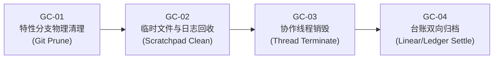

# 《多Bot协同任务拆解与自动推进执行规范（SOP）》
**Multi-Bot Autonomous DAG Orchestration & Lifecycle GC SOP**

- **版本**: v4.1.0-APEX
- **制定角色**: 项目调度员 (TPM & DAG 调度器)
- **执行范围**: OpenMausBot 全专家中台（架构师、全栈开发、测试质保、代码评审、运维、情报官、CPO）
- **核心准则**: 零打扰自治调度 (Zero-Interruption Autonomous Orchestration)、拓扑门禁硬性锁定、两振出局熔断、线程生命周期 GC

---

## 1. 核心哲学与执行准则 (Core Philosophy)

### 1.1 零打扰自治调度原则
传统敏捷软件开发中的人肉催办、同步站会与碎片化确认已被证明在多 Agent 协同体系中极度低效。本规范确立**“零打扰自治推进（Zero-Interruption Autonomous Orchestration）”**为第一性原则：
1. **彻底废除形式主义 User Story**：任务颗粒度强制采用 **`[动词] + [对象] + [确定性 Done-When]`** 结构化声明。
2. **凭证驱动与异步对账**：Bot 之间的交接不依赖自然语言客套，100% 依赖可验证的物理凭证（ADR 文档、Git Commit/PR、自动化测试报告、安全审查签名）。
3. **Durable Suspension（静默挂起）**：调度器派发任务后进入挂起状态，通过事件回调或被动唤醒处理下游，严禁在无事件状态下反复轮询消耗 Token。

### 1.2 冲突裁决与优先级铁律
在多任务与多 Bot 并行场景下，严格执行六级冲突裁决序列：
1. **拓扑无环与门禁硬锁定**：前置节点未获物理凭证（QA != PASS），下游严格锁定，禁止抢跑。
2. **零打扰自治推进**：优先异步事件流转，严禁中途非必要弹窗或打扰人类用户。
3. **两振出局熔断**：单一节点连续打回 2 次立即硬冻结并拉起架构会诊，杜绝无效重试烧干 Token。
4. **资源与上下文 GC**：任务完成后立即执行线程与工作区垃圾回收，防范内存与上下文悬挂。
5. **吞吐率与并发控制**：在满足前述约束下最大化槽位并发（默认并发槽位 $\le 3$）。
6. **展示与标签对账**：状态实时同步至 Linear / GitHub Projects。

---

## 2. 四阶+GC 标准流水线与门禁矩阵 (Pipeline & Gates)

全系统复合需求与开发任务严格划分为标准化五阶段流转流水线：

```mermaid
flowchart TD
    classDef locked fill:#2d3748,stroke:#4a5568,stroke-width:2px,color:#a0aec0;
    classDef running fill:#2b6cb0,stroke:#3182ce,stroke-width:2px,color:#ffffff;
    classDef pass fill:#22543d,stroke:#38a169,stroke-width:2px,color:#ffffff;
    classDef halt fill:#742a2a,stroke:#e53e3e,stroke-width:2px,color:#ffffff;

    P1["Phase 1: 契约与方案门禁<br/>(软件架构师 / CPO / 情报官)"]:::pass -->|ADR & Schema 锁定| P2["Phase 2: 原子实现与TDD<br/>(全栈开发)"]:::pass
    P2 -->|Commit & 单测绿灯| P3["Phase 3: 独立质量与E2E<br/>(测试质保员)"]:::running
    P3 -->|QA != PASS (Strike 1)| Rework["定向修复自愈 (Rework)"]:::running
    Rework -->|连续 2 次失败 (Strike 2)| Breaker["两振出局硬熔断 (BLOCKED)<br/>拉起架构师+CPO会诊"]:::halt
    P3 -->|QA == PASS 物理凭证| P4["Phase 4: 安全审计与PR交付<br/>(代码评审员 / 运维工程师)"]:::locked
    P4 -->|PR APPROVED & 合并| P5["Phase 5: 线程与环境生命周期 GC<br/>(项目调度员 TPM)"]:::locked
```

### 详细阶段契约

| 阶段 | 核心任务 | 责任 Bot | 准入条件 (Entry Criteria) | 退出基准 (Exit Gate) | 物理验收凭证 (Physical Evidence) |
| :--- | :--- | :--- | :--- | :--- | :--- |
| **Phase 1: 契约与方案门禁** | 架构决策与接口契约锁定 | 软件架构师<br/>CPO / 技术情报官 | 1. 业务需求输入明确<br/>2. CPO 认知预算审查通过 ($O \ge 12$, CL-01~06 无红线) | 1. 架构拓扑与接口定义明确<br/>2. 数据模型防腐层 (ACL) 锁定 | 1. 架构决策记录 (`ADR-*.md`)<br/>2. OpenAPI / JSON Schema 语法全绿 |
| **Phase 2: 原子实现与 TDD** | 特性代码开发与单元测试 | 全栈开发 | 1. Phase 1 ADR 物理存在且全绿锁定<br/>2. 独立特性分支已检出 (`feat/*` 或 `fix/*`) | 1. 测试用例先行 (红灯->绿灯)<br/>2. 核心逻辑原子实现<br/>3. 单测全绿且无新增债务 | 1. 独立分支 Git Commit Hash<br/>2. 本地单元测试通过日志 (Exit Code 0, 覆盖率符合门禁) |
| **Phase 3: 独立质量与 E2E** | 自动化端到端与集成验证 | 测试质保员 | 1. Phase 2 交付 Commit 且单测全绿<br/>2. 部署/测试沙箱及 Mock 服务就绪 | 1. 端到端功能闭环验证<br/>2. 边界条件、丢包与超时容灾演练通过 | 1. 自动化 E2E 测试运行报告 (`QA_STATUS: PASS`)<br/>2. 0 严重缺陷凭证 |
| **Phase 4: 安全终审与 PR** | 代码审计、安全防护与 PR | 代码评审员<br/>运维工程师 | 1. Phase 3 `QA_STATUS == PASS`<br/>2. 代码 Diff 清晰无悬挂更改 | 1. SAST 静态代码扫描无高危漏洞<br/>2. 遵循 Clean Architecture 规约<br/>3. 运维发布 Runbook 确认 | 1. GitHub PR 链接<br/>2. 代码评审员签字凭证 (`CR_STATUS: APPROVED`) |
| **Phase 5: 线程与生命周期 GC** | 会话清理、分支回收与归档 | 项目调度员 (TPM) | 1. PR 已合入主干（或获得最终发布授权）<br/>2. 全流程验收通过 | 1. 临时分支与 Scratchpad 物理删除<br/>2. 跨 Bot 协作 Thread 显式关闭<br/>3. 台账归档至 Linear / Projects | 1. 临时分支删除日志<br/>2. 最终对账台账 (`PLAN_DAG.json: COMPLETED`) |

---

## 3. 任务台账机制与三态槽位锁定调度 (Ledger & 3-State Locking)

### 3.1 状态机定义
任务拓扑节点严格遵循五态确定性状态机：
1. **`LOCKED`**：前置依赖中存在未完成项（或未提供合格物理凭证）。下游对任何调度输入处于硬锁定状态。
2. **`READY`**：所有前置依赖节点均为 `COMPLETED` 状态，且物理凭证核验通过，任务进入可调度就绪队列。
3. **`RUNNING`**：调度器分配并发槽位（Slot），生成专属执行 Thread，向责任 Bot 派发任务，调度器进入静默挂起。
4. **`REWORKING`**：在验收门禁（QA/评审）中遭遇打回，振数（Strike）= 1，处于定向自愈重工阶段。
5. **`COMPLETED`**：责任 Bot 提交符合要求的物理凭证，调度器对账核验无误，标记完成。
6. **`BLOCKED`**：触发两振出局（Strike = 2）或不可抗力阻断，节点冻结，全局发出告警。

### 3.2 自治推进流转算法（Autonomous Propagation Algorithm）

调度器以事件驱动方式自治推进全图流转，执行循环如下：

```text
Algorithm: Autonomous_DAG_Propagation
Input: PLAN_DAG.json, Event_Notification

1. On Event (Node_Completed | Node_Rework | Node_Error):
2.    node = GetNode(Event.node_id)
3.    If Event.type == Node_Completed:
4.        VerifyPhysicalEvidence(node.exit_gate)
5.        If Evidence.Valid == TRUE:
6.            node.status = COMPLETED
7.            node.completed_at = CurrentTimestamp()
8.        Else:
9.            TriggerRework(node, "Invalid physical evidence")
10.   Else If Event.type == Node_Rework:
11.       node.strike_count += 1
12.       If node.strike_count >= 2:
13.           node.status = BLOCKED
14.           TriggerCircuitBreaker(node)
15.           Return
16.       Else:
17.           node.status = REWORKING
18.           DispatchToBot(node.assigned_bot, Rework_Instructions)
19.
20.   // 拓扑扫描与下游解锁
21.   For each target_node in PLAN_DAG.nodes where target_node.status == LOCKED:
22.       unsettled = [dep for dep in target_node.depends_on if getNode(dep).status != COMPLETED]
23.       If length(unsettled) == 0:
24.           target_node.status = READY
25.
26.   // 槽位派发
27.   running_slots = count(nodes where status in [RUNNING, REWORKING])
28.   available_slots = max(0, concurrency_limit - running_slots)
29.   For each ready_node in PLAN_DAG.nodes where ready_node.status == READY:
30.       If available_slots <= 0: Break
31.       AllocateSlotAndDispatch(ready_node)
32.       ready_node.status = RUNNING
33.       available_slots -= 1
34.
35.   If all nodes == COMPLETED:
36.       TriggerPhase5_GC()
37.       global_status = COMPLETED
```

---

## 4. 两振出局（Two-Strike）熔断机制

为杜绝大模型在代码开发与调试中陷入无限无效重试、燃烧上下文与消耗 Token，制定两振出局硬性熔断规约：

### 4.1 振数计数与流转规则
- **Strike 1（初次失败）**：
  - 测试质保员或代码评审员驳回交付物时，必须输出结构化驳回诊断单：`{ failed_tests, root_cause_hint, exact_diff_context }`。
  - 调度器记录 `strike_count = 1`，将任务状态重置为 `REWORKING`，唤醒原执行 Bot（如全栈开发）针对具体失败点进行单点定向自愈重试。
- **Strike 2（二次失败）**：
  - 若在自愈重工后，第二次测试/评审仍未达到 PASS 门禁，调度器**严禁发起第三次重试**。
  - 立即就地硬锁定当前节点及所有受阻下游，节点状态置为 `BLOCKED`，全局状态置为 `CIRCUIT_BROKEN`。

### 4.2 熔断后跨角色联合会诊响应
触发 Strike 2 熔断时，调度器自动执行以下动作：
1. **冻结分支与现场保留**：锁定当前特性分支，保存现场测试日志与 Diff 快照至 `scratch/diagnostics/`。
2. **拉起紧急联合会诊**：
   - 自动向【软件架构师】（Spec 制定者）与【产品战略师】（需求定义者）派发会诊工单。
   - 分析根因维度：
     - *规格歧义*：架构契约是否存在隐式假设或不可达成指标？
     - *技术盲区*：当前技术选型或依赖库是否存在底层 Bug / 协议缺陷？
     - *业务范围溢出*：需求是否超出本次迭代认知预算？
3. **输出裁决单**：
   - 由架构师出具《修正案（Addendum）》或调整契约后，重置 Strike 计数并重新解锁节点，或直接砍掉该死锁特性（Killed Scope）。

---

## 5. 线程与上下文生命周期 GC 规约 (Lifecycle GC Protocol)

任务完成后，僵尸分支、临时测试文件与长生命周期 Bot 会话是导致 Token 膨胀和环境漂移的罪魁祸首。全流程强制贯彻四重垃圾回收（GC）：



### 5.1 GC 实施细则
1. **GC-01 特性分支物理清理**：
   - 必须通过 PR 合并入主干，严禁直接向 main 推送。
   - PR 成功合并后，立即调用 Git 工具物理删除本地与远端临时特性分支（`git branch -D feat/*`）。
2. **GC-02 临时工作区与 Scratchpad 清理**：
   - 扫描并清理执行过程中产生的临时中间数据、测试 Mock 缓存与临时脚本（`rm -rf scratch/* /tmp/*`）。
   - 仅保留持久化交付物：代码库、ADR、正式测试报告与归档台账。
3. **GC-03 跨 Bot 协作线程销毁**：
   - 任务完成后，调度器向所有参与该任务的专用执行线程（Thread）发出生命周期终止信号。
   - 强制重置子会话上下文，释放运行时内存与模型 Prompt Cache 挂载，杜绝跨任务上下文污染。
4. **GC-04 状态台账固化与双向对账**：
   - 将运行时 `PLAN_DAG.json` 固化为不可篡改的结算状态（`SETTLED`）。
   - 双向同步至 Linear / GitHub Projects，关闭关联 Issue。

---

## 6. 轻量级状态台账规范 (PLAN_DAG.json)

系统通过统一的轻量级 JSON 台账在磁盘与内存中持久化拓扑与执行状态。

### 6.1 Schema 核心契约 (`PLAN_DAG.schema.json`)
台账顶层包含项目元数据、全局状态、并发控制与节点拓扑：
- `dag_id`: 唯一拓扑 ID，格式 `DAG-YYYYMMDD-[MODULE]`
- `concurrency_limit`: 最大并发运行节点数（推荐 2~3）
- `strike_policy`: 熔断策略与最大容忍振数（固定为 2）
- `nodes`: 拓扑节点数组，每个节点严格声明：
  - `node_id`: 节点编号（如 `N01-SPEC-LOCK`）
  - `phase`: 阶段枚举 (`PHASE_1_SPEC_GATE` ~ `PHASE_5_GC_CLOSURE`)
  - `action_title`: 结构化动作名称（动词 + 对象）
  - `assigned_bot`: 指派的专家 Bot 信息及专属 Thread ID
  - `depends_on`: 前置强依赖节点 ID 数组
  - `status`: 当前五态之一 (`LOCKED` / `READY` / `RUNNING` / `REWORKING` / `COMPLETED` / `BLOCKED`)
  - `strike_count`: 累计被打回次数（0 ~ 2）
  - `entry_criteria`: 准入前置要求
  - `done_when`: 确定性完工标准
  - `exit_gate`: 退出核验类型与物理凭证路径

---

## 7. 容灾与降级阶梯 (Resilience Ladder)

- **D0 标态 (Standard)**：全链路全自动推进，节点一次性全绿交付，Phase 5 触发即刻完成 GC。
- **D1 局部抖动 (Minor Rework)**：出现 Strike 1 单点未达标，责任 Bot 5 分钟内定向自愈，关键路径微调，不打扰全局。
- **D2 两振熔断 (Circuit Breaker)**：连续 2 次被打回，触发硬熔断，挂起当前分支，唤醒架构师与 CPO 进行规格裁决，产出修正案。
- **D3 僵尸线程自愈 (Deadlock Timeout)**：若分配槽位的节点超过设定阈值无响应（Heartbeat Timeout），调度器强制回收槽位，将节点标记为 TIMEOUT，拉取现场日志并向运维工程师告警。

---
*本规范由项目调度员 (TPM) 制定，即日起作为全系统多 Bot 协同唯一法定执行纪律。*
